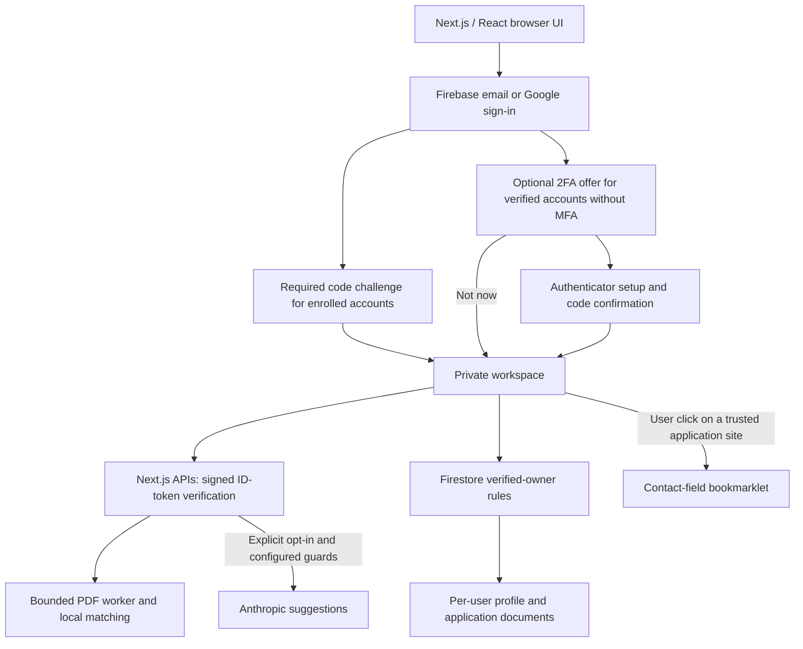

# ACA engineering and security audit

Review date: 2026-10-21. Scope: the current Next.js application, Firebase account
and data integration, Google login, authenticator MFA, optional sign-in prompt,
resume parsing, matching, tracker, backups, Fill-Assist, and release safeguards.

This is an internal, evidence-based engineering review, not an independent
penetration test, compliance certification, or guarantee that every deployment
setting has been audited. Historical reports remain historical; this report
supersedes their feature descriptions for the current application.

## Overall assessment

**Working beta, suitable for a limited audience with explicit limitations.**
Core workflows have automated coverage and deployed authentication has been
exercised with disposable accounts. A wider public-launch claim still requires
operational evidence: alert delivery, restoration, account deletion/privacy
processes, capacity/cost validation, and release protections.

## Architecture and trust boundaries

- Next.js App Router provides public landing/account routes, protected workspace
  and Security routes, and server APIs. TypeScript defines shared data shapes.
- Authentication is delegated to Firebase; ACA integrates provider flows and
  authorization rather than implementing password hashing or custom MFA crypto.
- Profiles live at `users/{uid}/profile/current`; applications live at
  `users/{uid}/applications/{id}`. Firebase Authentication stores account/provider
  and factor records separately from Firestore.
- Original PDFs are parsed by the server, not stored by the application's upload
  code. Extracted resume text and profile fields are saved in the private profile.
- Deployment is on Vercel. There is no separate FastAPI service, PostgreSQL/vector
  database, background application-submission cluster, or repository crawler.

## Feature inventory

| Feature | Current behavior and evidence | Boundary or limitation |
| --- | --- | --- |
| Email accounts | Registration, email verification, sign-in, sign-out, and password-reset email request are exercised in browser tests. Verification opens the generated emulator email link in a separate browser session. | Emulator testing does not certify production email delivery. Password reset is not an MFA bypass. |
| Google accounts | Firebase popup registration, cancellation, returning sign-in, saved-profile persistence, and account isolation are tested in emulators. The deployed button has reached Google's real sign-in page without entering credentials. | Real Google consent completion and MFA reauthentication on physical browsers remain manual checks. |
| Authenticator 2FA | Optional TOTP enrollment, local QR/manual key, valid-code confirmation, login challenge, additional authenticators, and reauthenticated removal. A real Firebase test uses and deletes a disposable verified account. | No ACA recovery codes. Lost-factor recovery requires an established, trusted administrator process. |
| Sign-in 2FA offer | Verified users without enrolled factors see Set up 2FA / Not now before the workspace. Setup opens identity confirmation directly. | This is optional enrollment. Enrolled users cannot skip their required Firebase challenge. |
| Session behavior | Firebase browser-session persistence; memory-only Firestore caching; workspace snapshots clear on sign-out. | No promise that every previously issued ID token is immediately invalidated after a security change. |
| Resume parsing | PDF text plus safe embedded link annotations; GitHub links can be recognized without a URL scheme. GitHub, LinkedIn, website, and portfolio remain distinct. | Heuristics and a known skill vocabulary; scanned-image PDFs lack OCR, and unusual layouts can require corrections. ACA does not visit GitHub repositories. |
| Match scoring | Log-weighted term-frequency cosine similarity plus known-skill coverage. When known job skills exist, the blend is 45% text similarity and 55% skill coverage; otherwise it uses text similarity. | An explainable heuristic, not an embedding model, vendor-certified ATS score, or hiring probability. |
| Suggestions | Local suggestions work without a model. Optional Anthropic suggestions use consent, filtered/bounded input, validation, caching, and shared budget guards. | No live paid-provider acceptance/cost test in this review. Filtering is heuristic and does not guarantee removal of all personal information. |
| Application tracker | User-owned status records, deduplication, transactional updates, persistence, and cross-account isolation. | No automatic job discovery, application submission, or guaranteed compatibility with every ATS. |
| Fill-Assist | The actual UI-generated bookmarklet fills 13 supported contacts in an external-origin React form; 14 protected controls remain unchanged; user edits survive repeat runs; no submission occurs. | Synthetic form coverage, not every employer website. Custom widgets, inaccessible iframes, work history, screening answers, and file uploads remain manual. |
| Backup/import | Validated private JSON exports/imports, deduplication and recovery snapshots are covered by tests. | User exports are not a tested operator disaster-recovery system. |

## Reviewed controls

| Control | Implementation evidence |
| --- | --- |
| API authentication | `lib/firebase-server.ts` verifies signed Firebase ID tokens and verified-email claims before processing personal input. Client UIDs are not trusted. |
| Database authorization | `firestore.rules` requires the verified owner, restricts fields/types/sizes, preserves application identity, and denies undefined paths. |
| MFA enforcement | Firebase resolves the second factor before issuing the completed sign-in. Setup alone does not enable MFA; the authenticator code must be accepted. Security changes request fresh authentication. |
| Optional-offer preference | `lib/mfa-offer.ts` stores only the dismissing UID in sessionStorage. The provider retains an in-memory fallback, resets the choice on sign-out/auth failure, and checks actual Firebase factors independently. This preference is not an authorization flag. |
| Upload isolation | Stream byte limits, a 4 MiB file limit plus bounded multipart overhead, at most 20 PDF pages, 100,000 extracted characters, worker heap/time limits, and bounded admission. |
| Web security | Nonce-based CSP, exact configured Firebase auth frame origin, clickjacking protection, restrictive permissions, same-origin/content-type checks, and safe error responses. |
| Secret handling | Environment files and local Firebase/Vercel state are ignored; staged changes are scanned without displaying secret values. MFA keys/codes are not persisted in Firestore or application logs. This is not a fresh exhaustive Git-history secret scan. |
| AI cost controls | Redis-backed atomic reservations and caching, a signed visitor session, daily attempt ceiling, fail-closed paid calls, and local fallbacks. Session allowances are not a strict per-person quota. |
| Release checks | The CI workflow defines lint, types, regression tests, production audit/build, packaging checks, browser tests, and emulator security tests. Its presence does not prove branch protection is enabled or that every remote run is green. |

## Findings and remaining risks

Severity is a prioritization aid. “Not verified” identifies missing operational
evidence; it does not assert that an external service is misconfigured.

| Priority | Finding | Required follow-up |
| --- | --- | --- |
| P1 — before a wider launch | Operator alert delivery and response arrangements are not verified. | Configure and exercise uptime/error alerts and assign an owner. |
| P1 — before a wider launch | Operator backup restoration and rollback drills are not demonstrated. | Define recovery targets, test a restore in isolation, and demonstrate a release rollback. |
| P1 — before a wider launch | Full account/data deletion and a published privacy notice are absent from the reviewed UI/routes. | Implement/test deletion across Auth and user data; publish the actual data-use/retention policy. |
| P1 — before enabling paid AI broadly | Live provider spend limits, Redis configuration, edge abuse controls, and expected traffic capacity require confirmation. | Verify provider-side spend limits and load/abuse behavior. Do not equate a per-instance parser limit with a global traffic limit. |
| P1 — before relying on MFA recovery at scale | No self-service recovery codes and no demonstrated administrator identity-verification procedure. | Establish a trusted recovery process, preserve remaining factors, and document support responsibilities. Never reset MFA solely because someone knows an email/UID. |
| P2 — developer tooling | Full npm audit reports five high-severity affected packages in the development-only braces/micromatch/fast-glob/Next ESLint chain. Production audit reports zero. | Track the upstream advisory; lint trusted repository inputs. The proposed major downgrade of Next ESLint is not a safe blind fix. |
| P2 — broader compatibility | Real Google MFA consent/reauthentication, physical authenticator scanning, Safari/mobile behavior, and diverse real employer forms are not exhaustively tested. | Run a defined device/browser/form matrix before making broad compatibility claims. |
| P2 — release governance | Required CI checks and branch protections are not verified from the repository workflow alone. | Confirm repository settings and deployment permissions. |
| P3 — presentation | The production build warns that metadataBase is unset for absolute social-image URLs. | Set a canonical production metadata origin in a separate small change. |

The dependency finding is [GHSA-vfj7-8cjw-p6xm](https://github.com/advisories/GHSA-vfj7-8cjw-p6xm).
An empty production dependency audit is useful evidence, not proof that the
application has no security vulnerabilities.

## Verification record

Confirmed in this change:

- TypeScript checks passed.
- 48 regression tests passed, including session-scoped optional-offer behavior.
- Auth/Firestore emulator browser flow passed: email verification, pre-workspace
  offer, skip/reload/new-sign-in/account-switch behavior, Google setup entry and
  cancellation, parsing, matching, tracking, persistence, and Fill-Assist.
- `npm audit --omit=dev`: zero findings. Full audit: five high development-only
  findings in the dependency chain listed above.

- `npm run lint`, the production Webpack build, PDF packaging verification, and
  production landing/login/register/protected-route browser checks passed.
- `npm run test:firebase`: all four adversarial Firestore rule tests passed.
- The updated opt-in real-Firebase browser helper passed using one disposable
  account: the pre-workspace setup entry, cancellation, incorrect-password/code
  rejection, confirmed enrollment, required MFA with no skip for enrolled users,
  protected removal, and the optional offer after removal. The account was
  deleted afterward; no credentials, setup keys, or user records were printed.

The build was verified locally with `NEXT_BUILD_DIR=.next-verify` and
`next build --webpack`; the Git-triggered Vercel build uses the normal configured
Next.js build. The real-Firebase lifecycle helper is an explicitly authorized
operator test, not an unattended CI job. Future changes require fresh evidence;
these results apply to this reviewed changeset.

## Honest launch and interview claims

Describe ACA as a deployed full-stack beta with tested authentication, private
data isolation, PDF parsing, heuristic matching, and user-controlled autofill.
Do not claim a completed independent security audit, universal ATS compatibility,
fully autonomous job applications, a custom-trained AI model, proven large-scale
traffic capacity, or regulatory compliance based on these tests.

See [RECRUITER_GUIDE.md](RECRUITER_GUIDE.md) for a concise pitch, architecture
walkthrough, defensible resume bullets, demo plan, and technical interview Q&A.
