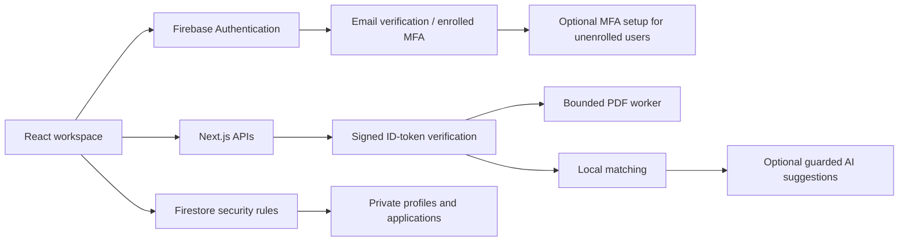

# ACA — Autonomous Career Agent

[](https://github.com/Manmeet-07/a.c.a-Project/actions/workflows/ci.yml)

**A full-stack workspace for understanding your resume, comparing job requirements, and tracking applications.**

ACA extracts a candidate profile from a PDF, identifies matched and missing job
skills, saves application progress, and helps fill contact fields on application
forms. Users review the information and submit applications themselves.

[Live application](https://aca-lemon.vercel.app) · [Documentation](docs/README.md) ·
[Firebase setup](docs/getting-started/firebase.md) · [Deployment](docs/deployment/vercel.md) ·
[Project presentation](docs/project/recruiter-guide.md)

> **Project status: working beta.** Core workflows have automated coverage.
> Broader launch requirements and test limitations are documented in the
> [production-readiness checklist](docs/security/production-readiness.md).

## Contents

- [Features](#features)
- [Technology stack](#technology-stack)
- [Architecture](#architecture)
- [Run locally](#run-locally)
- [Commands and verification matrix](#commands-and-verification-matrix)
- [Repository structure](#repository-structure)
- [Security and data handling](#security-and-data-handling)
- [Scope and limitations](#scope-and-limitations)
- [Documentation](#documentation)

## Features

| Capability | What ACA provides | Important boundary |
| --- | --- | --- |
| Resume profiles | PDF text extraction, editable contact details, embedded web links, and normalized technical skills. | Image-only PDFs require OCR, which is not included. |
| Job matching | A deterministic 0–100 score, matched/missing skills, and suggestions grounded in the candidate's profile. | The score is a heuristic, not a hiring probability or vendor-certified ATS result. |
| Optional AI suggestions | Anthropic-assisted wording with consent, validation, shared budget guards, and local fallbacks. | The matching score remains deterministic; paid services need separate configuration. |
| Application tracking | Private saved roles, workflow statuses, notes, deduplication, and account synchronization. | Applications are reviewed and submitted by the user. |
| Fill-Assist | A user-triggered bookmarklet for recognizable contact controls, including React-controlled forms. | Custom widgets, work history, screening responses, and inaccessible iframes may require manual entry. |
| Accounts | Firebase email/password registration, email verification, Google sign-in, and reset-email requests. | A verified account is required to use the workspace. |
| Two-factor authentication | Optional authenticator setup before the workspace; required code challenges for enrolled users. | “Not now” skips enrollment, not an enrolled account's challenge. |
| Data portability | Validated JSON export/import and explicit migration of legacy browser data. | User exports do not replace an operator backup-and-restore plan. |

## Technology stack

| Layer | Tools | Role |
| --- | --- | --- |
| Application framework | Next.js 16.4.2, React 19.2.4 | App Router pages, interactive UI, and server Route Handlers. |
| Language and styles | TypeScript 5, Tailwind CSS 4, application CSS | Shared data types, layout, responsive styling, and component presentation. |
| Motion and typography | GSAP, `@gsap/react`, Lenis, Geist, Instrument Serif | UI transitions, scroll interactions, and bundled fonts. |
| Identity | Firebase Authentication, Firebase Admin SDK | Email/Google identity, signed-token verification, and authenticator MFA integration. |
| Database | Cloud Firestore | UID-scoped profiles and application documents, protected by security rules. |
| PDF processing | `pdf2json`, `pdf-lib`, Node.js worker threads | Bounded text/link extraction outside the main event loop. |
| Matching | Local TypeScript scoring and skill vocabulary | Term-frequency cosine similarity and explicit skill coverage. |
| Optional AI | Anthropic SDK; Redis REST-compatible store | Validated suggestions, caching, and shared usage reservations. |
| Authenticator setup | Firebase TOTP APIs, `qrcode` | Firebase-enforced verification and locally rendered setup QR codes. |
| Testing | Node.js test runner, Playwright, Firebase Emulator Suite | Regression checks, browser workflows, and adversarial database-rule tests. |
| Quality and delivery | ESLint, TypeScript checks, GitHub Actions, Vercel | Static checks, CI verification, and application hosting. |

Exact dependency versions and available scripts are recorded in
[`package.json`](package.json); [`package-lock.json`](package-lock.json) locks the dependency tree.

## Architecture



The UI, server APIs, and PDF worker are maintained in one repository. Firebase
supplies identity and database services; Vercel hosts the Next.js application.

## Run locally

### 1. Install prerequisites and dependencies

| Prerequisite | Requirement |
| --- | --- |
| Node.js and npm | Node.js 22 is the project's recommended version, as recorded in [`.nvmrc`](.nvmrc). The package engine accepts Node.js `>=22 <25`. |
| Firebase project | A registered web app, email/password authentication, and a Firestore database with the project's rules. |
| Java | Java 21 or later for Firebase emulator tests; not required for normal development. |
| Chromium | An installed compatible browser or a Playwright Chromium installation for browser tests. |

```bash
git clone https://github.com/Manmeet-07/a.c.a-Project.git
cd a.c.a-Project
npm ci
```

### 2. Configure Firebase

Copy the environment template using the command for your shell:

```powershell
# PowerShell
Copy-Item .env.example .env.local
```

```bash
# macOS / Linux
cp .env.example .env.local
```

Fill the values in `.env.local` from your Firebase web app configuration:

| Variable | Purpose |
| --- | --- |
| `NEXT_PUBLIC_FIREBASE_API_KEY` | Firebase web API key. |
| `NEXT_PUBLIC_FIREBASE_AUTH_DOMAIN` | Firebase authentication domain. |
| `NEXT_PUBLIC_FIREBASE_PROJECT_ID` | Firebase project used by the browser. |
| `NEXT_PUBLIC_FIREBASE_APP_ID` | Registered Firebase web app ID. |
| `FIREBASE_PROJECT_ID` | Server project ID; must match the browser project. |

The `NEXT_PUBLIC_*` values are public web configuration. Authorization is enforced
by signed tokens and database rules. Keep private keys, passwords, and server
credentials out of source control. `.env.local` is ignored by Git.

Follow [Firebase setup](docs/getting-started/firebase.md) for provider/domain/rule
configuration and [two-factor setup](docs/security/two-factor-authentication.md)
for optional TOTP provisioning. Forks should select their own Firebase project
before running any deployment command.

### 3. Start the application

```bash
npm run dev
```

Open [localhost:3000](http://localhost:3000). Register and verify an email address,
or use a configured Google provider. Unenrolled users can choose **Set up 2FA**
or **Not now** before opening the workspace.

For a local production preview:

```bash
npm run build
npm start
```

Local parsing, scoring, and suggestions do not require an Anthropic key. Optional
AI prerequisites and spend safeguards are covered in the
[deployment guide](docs/deployment/vercel.md#required-before-enabling-paid-ai).

## Commands and verification matrix

Run commands from the repository root. Browser suites start and stop their own
application server; do not start a second server for them.

| Command | Purpose | Prerequisite |
| --- | --- | --- |
| `npm ci` | Install the locked dependencies. | Supported Node.js and npm. |
| `npm run dev` | Start development with hot reload. | Firebase configuration for account workflows. |
| `npm run build` | Create the production application. | Installed dependencies; production web configuration for real use. |
| `npm start` | Serve the production build. | A successful production build. |
| `npm run lint` | Run repository ESLint checks. | Installed development dependencies. |
| `npm run typecheck` | Run TypeScript without emitting files. | Installed development dependencies. |
| `npm test` | Run regression tests under `tests/*.test.cjs`. | Installed development dependencies. |
| `npm run test:pdf-package` | Check PDF worker dependencies in production traces. | A successful production build. |
| `npm run test:e2e` | Check production public pages and authentication boundaries. | Production build and Chromium. |
| `npm run test:firebase` | Start Firestore emulator and test database rules. | Java 21+; Firebase CLI is invoked through npm. |
| `npm run test:rules` | Run rules tests against an already-running emulator. | `FIRESTORE_EMULATOR_HOST`; prefer `test:firebase` for a managed run. |
| `npm run test:e2e:auth` | Run account, profile, matching, tracker, and autofill browser flows. | Java 21+, Chromium; local Auth/Firestore emulators are started automatically. |
| `npm audit --omit=dev` | Inspect production dependency advisories. | Registry access. |

Install Chromium if needed:

```bash
npx playwright install chromium
```

CI follows [`.github/workflows/ci.yml`](.github/workflows/ci.yml). Emulator suites
use the `demo-aca` project. Real TOTP lifecycle checks are separately authorized
operator tests, not unattended CI; see the
[MFA verification boundaries](docs/security/two-factor-authentication.md#verification).

## Repository structure

```text
app/                  App Router pages and API handlers
components/           Workspace, landing, and authentication UI
lib/                  Parsing, matching, auth, storage, and validation
types/                Shared TypeScript data contracts
workers/              Bounded PDF processing worker
config/               Reviewed MFA configuration
tests/                Regression suites, fixtures, and browser harnesses
docs/                 Setup, deployment, security, testing, and project guides
.github/workflows/    Continuous integration
firebase.json         Firebase service and emulator configuration
firestore.rules       Database authorization and schema rules
vercel.json           Next.js deployment and function configuration
```

## Security and data handling

- Processing APIs verify Firebase ID tokens and verified-email claims.
- Firestore rules restrict profiles and applications to their verified owner.
- Authenticator verification is enforced by Firebase, not a client-editable flag.
- Original PDFs are processed rather than stored; extracted text is saved in the profile.
- Optional AI receives bounded, filtered excerpts after consent; filtering does not guarantee removal of all personal information.
- Bookmarklets contain contact information. Use them only on trusted sites and review every filled field.

See [account security](docs/security/two-factor-authentication.md),
[production readiness](docs/security/production-readiness.md), and the
[dated engineering audit](docs/security/audit-2026-10-21.md) for evidence and limitations.

## Scope and limitations

ACA currently provides resume processing, explainable matching, private tracking,
and contact-field assistance. It does not include OCR, repository analysis,
automatic job discovery, unattended submission, or guaranteed compatibility with
every employer form. Matching uses a technical-skill vocabulary and local
similarity calculations rather than a custom-trained semantic model.

Monitoring, restore/rollback drills, account deletion/privacy workflows, traffic
capacity, and cost controls need operational verification before a wider launch.
Historical audit counts are dated evidence, not current security certification.

## Documentation

| Resource | Contents |
| --- | --- |
| [Documentation index](docs/README.md) | Reading paths and current versus historical records. |
| [Firebase setup](docs/getting-started/firebase.md) | Accounts, configuration, database rules, and emulator usage. |
| [Deployment guide](docs/deployment/vercel.md) | Vercel, optional AI, hosting limits, and monitoring. |
| [Two-factor authentication](docs/security/two-factor-authentication.md) | Setup, required challenges, recovery, and test coverage. |
| [Production readiness](docs/security/production-readiness.md) | Operational launch checklist. |
| [Fill-Assist verification](docs/testing/fill-assist.md) | Supported fields, protected controls, and browser-test boundaries. |
| [Recruiter guide](docs/project/recruiter-guide.md) | Project pitch, defensible resume bullets, and interview discussion. |
| [Historical records](docs/archive/README.md) | Preserved early plans and dated test/audit reports. |
