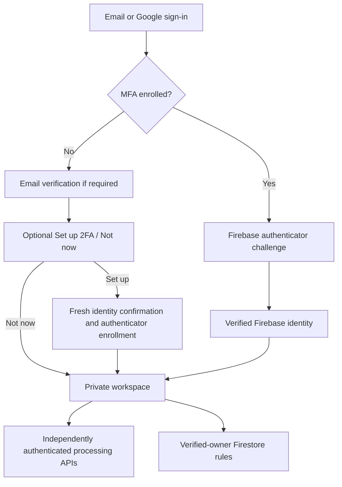

# Architecture and data flow

ACA is one Next.js application with a React frontend, Node.js Route Handlers,
managed Firebase identity/data services, and a bounded PDF worker. This guide
describes the repository implementation; the checked-in configuration does not
prove every external production setting has been applied.

## Component responsibilities

| Component | Responsibility | Source |
| --- | --- | --- |
| Public and account pages | Landing page, registration, sign-in, and account flow. | [`app/`](../app), [`components/auth/`](../components/auth) |
| Workspace UI | Profile editing, matching, tracker, and backup controls. | [`components/AppShell.tsx`](../components/AppShell.tsx) |
| Client identity | Session persistence, Google popup, MFA challenge, and optional setup offer. | [`lib/firebase-client.ts`](../lib/firebase-client.ts), [`lib/mfa.ts`](../lib/mfa.ts) |
| Server identity | Verify signed ID tokens and verified-email claims before processing. | [`lib/firebase-server.ts`](../lib/firebase-server.ts) |
| Database access | Live snapshots, transactions, account-bound writes, imports, and validation. | [`lib/storage.ts`](../lib/storage.ts), [`lib/workspace-data.ts`](../lib/workspace-data.ts) |
| Database authorization | Verified-owner access, schema limits, and default deny. | [`firestore.rules`](../firestore.rules) |
| Resume processing | Validate upload, reconstruct text, and read bounded safe PDF web-link annotations. | [`app/api/upload/route.ts`](../app/api/upload/route.ts), [`workers/pdf.cjs`](../workers/pdf.cjs) |
| Matching and suggestions | Normalize known skills, calculate similarity, and validate optional model output. | [`lib/skills.ts`](../lib/skills.ts), [`lib/ats.ts`](../lib/ats.ts), [`lib/ai.ts`](../lib/ai.ts) |
| Form assistance | Build a user-triggered contact-field bookmarklet that preserves existing answers. | [`lib/bookmarklet.ts`](../lib/bookmarklet.ts) |

## Route matrix

| Route | Method | Access | Purpose |
| --- | --- | --- | --- |
| `/` | GET | Public | Product overview and account entry. |
| `/login`, `/register` | GET | Public account UI | Firebase identity, verification, and required MFA challenge. |
| `/app` | GET | Verified account UI | Optional setup offer for unenrolled users, then workspace. |
| `/settings/security` | GET | Verified account UI | Authenticator enrollment and reauthenticated removal. |
| `/api/health` | GET | Public | Liveness check. |
| `/api/upload` | POST | Verified Firebase ID token | Multipart PDF processing. |
| `/api/tailor` | POST | Verified Firebase ID token | Validated local matching and optional guarded AI suggestions. |
| `/api/session` | POST | Verified Firebase ID token | Issue the signed visitor session used by optional AI guards. |

Page guards improve navigation; they are not the only access control. API token
verification and Firestore rules enforce their own boundaries. Firestore calls
use the authenticated SDK directly rather than a catch-all database API route.

## Identity and workspace flow

The skip choice is a session-scoped UI preference, not proof that MFA is enabled.
An enrolled user's required Firebase challenge cannot be skipped with that flag.
See [two-factor authentication](security/two-factor-authentication.md).

## Data lifecycle

| Data | Location or handling | Notes |
| --- | --- | --- |
| Account and enrolled factors | Firebase Authentication | Passwords are not stored in application Firestore documents. |
| Candidate profile | `users/{uid}/profile/current` | Extracted text, normalized skills, editable contacts, and metadata. |
| Saved applications | `users/{uid}/applications/{id}` | Job details, status, notes, and optional match results. |
| Original PDF bytes | Server processing memory/worker | The upload path does not persist the original file. |
| Authenticator setup key and QR | Client component state during enrollment | Not saved to Firestore or sent to a third-party QR service. |
| Optional AI request | Filtered and bounded server-side excerpts | Explicit user consent and valid configured guards are required. |
| AI cache and counters | Configured Redis REST service | Validated suggestions, hashes, locks, and budget metadata. |
| Exported backup | User-downloaded JSON | Users control exported copies; exports are not an operator restore plan. |
| Fill-Assist bookmark | User's browser | Contains a contact snapshot; browser synchronization may copy it. |

Firebase project administrators can inspect project data through their admin
permissions. Application users are restricted to their verified UID workspace.

## Processing limits and interpretation

Upload limits are defined in [`lib/limits.ts`](../lib/limits.ts): a 4 MiB file,
bounded multipart overhead, 20 pages, 100,000 extracted characters, and a
10-second parser deadline. The PDF worker has explicit heap limits and bounded
admission per process. These controls do not establish a global capacity limit.

When a job description contains recognized skills, matching blends 45% text
similarity with 55% skill coverage; otherwise it uses text similarity. The result
is a heuristic, not a calibrated hiring probability. Optional AI changes the
suggestions, not the deterministic score.

For operational requirements, use [deployment](deployment/vercel.md) and
[production readiness](security/production-readiness.md). For what the tests
exercise, use the [verification matrix](testing/README.md).
